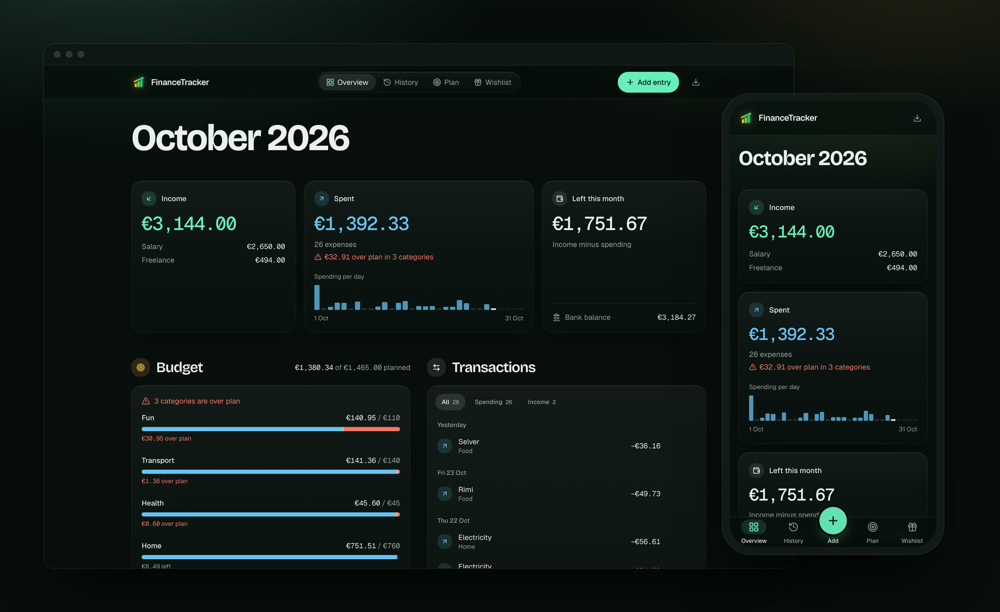
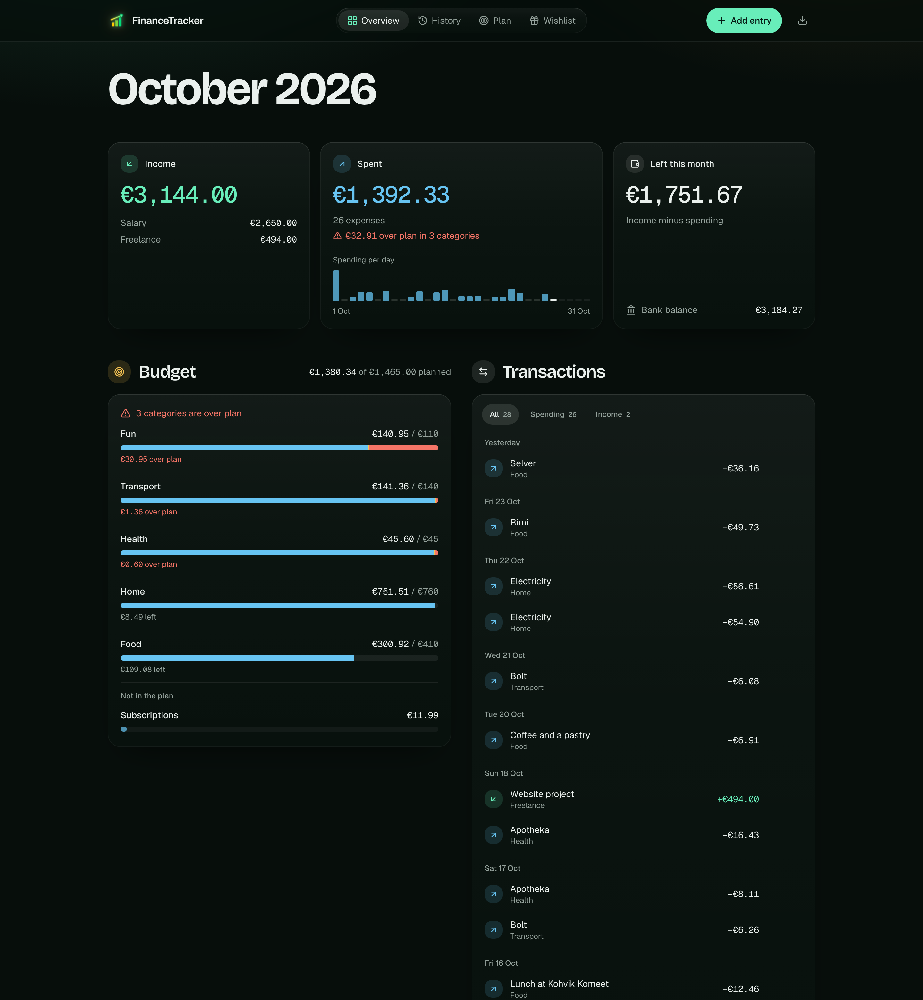
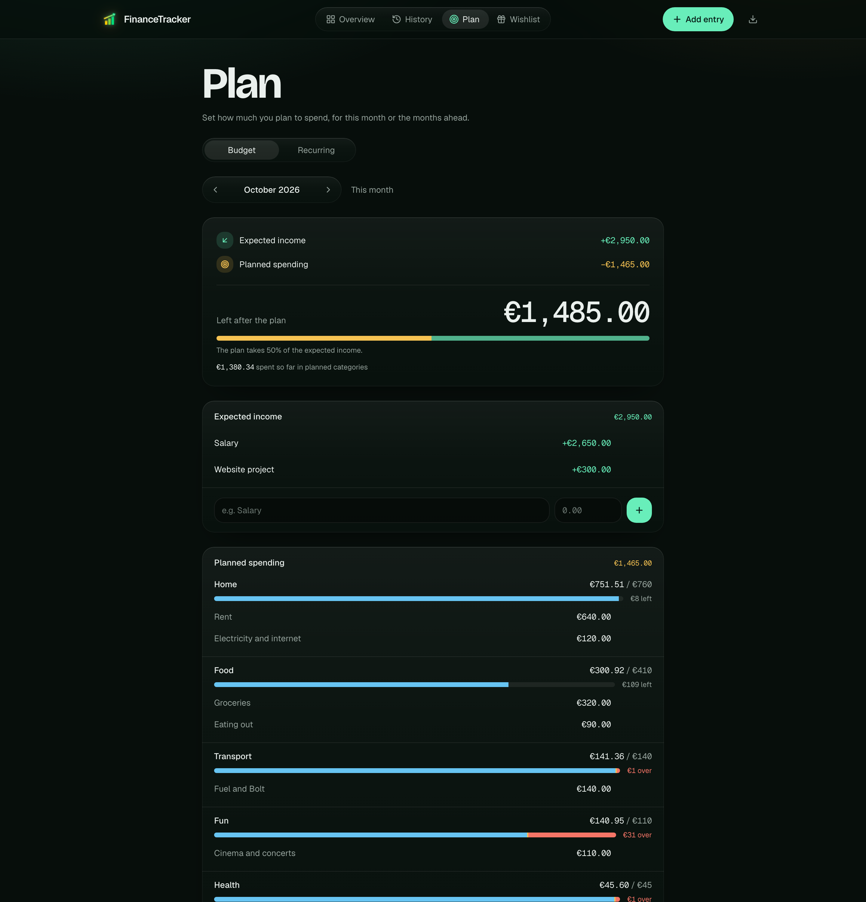
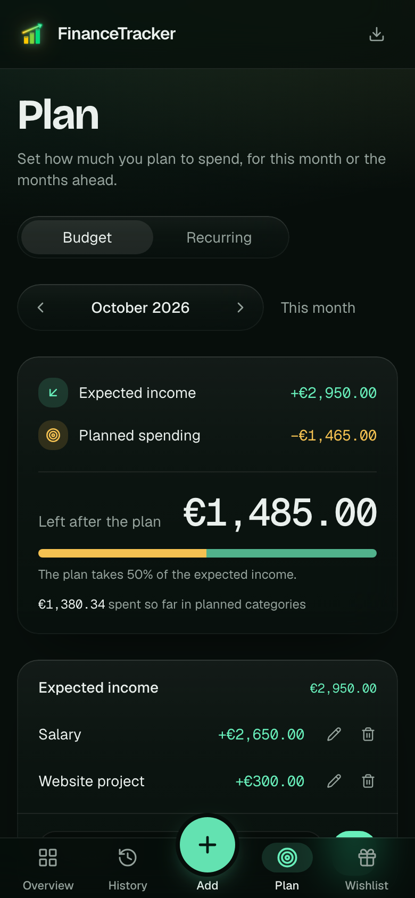
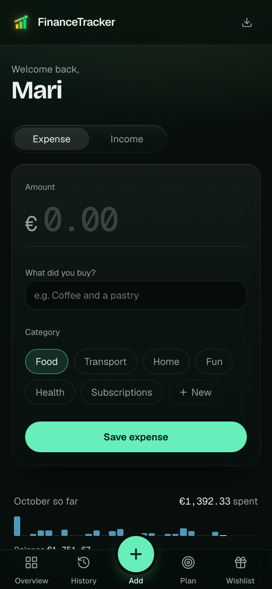
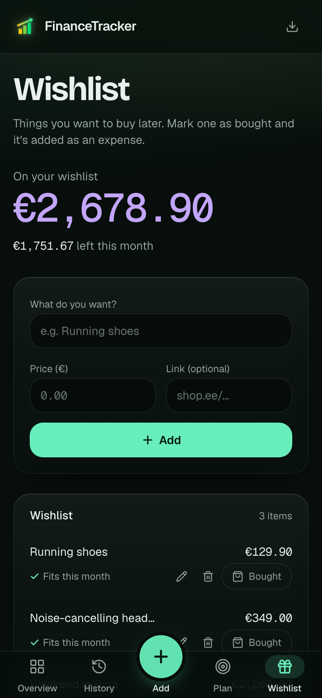
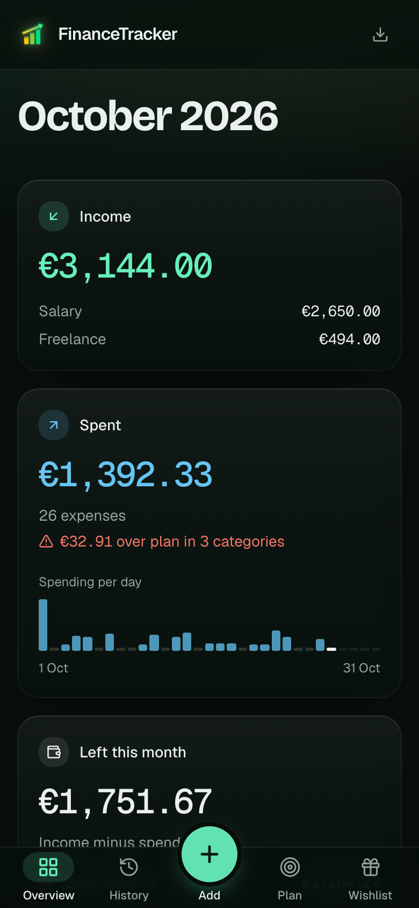
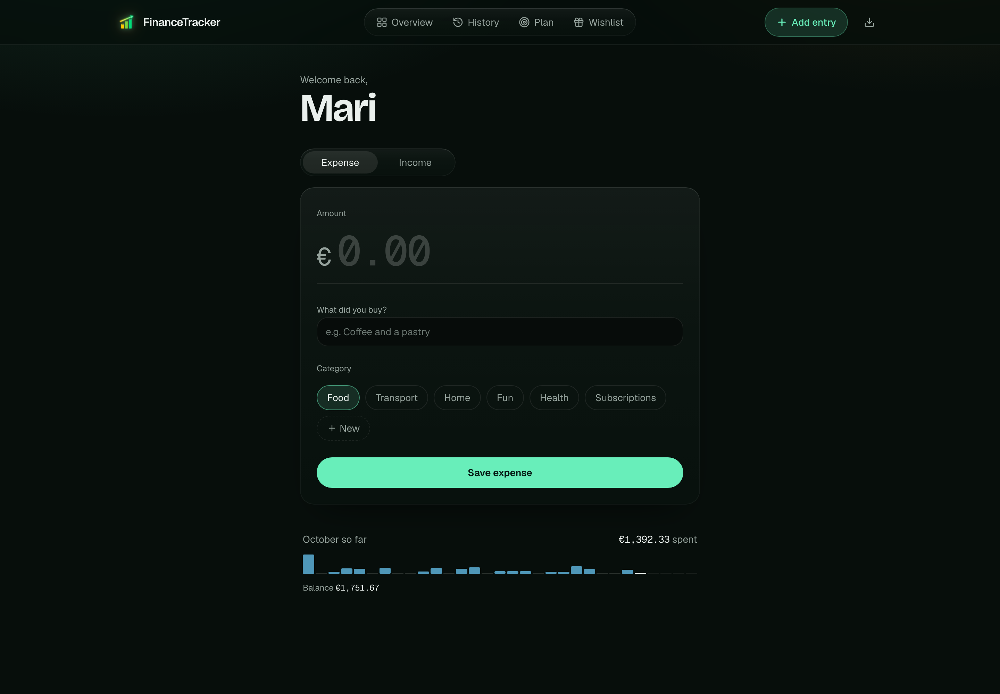
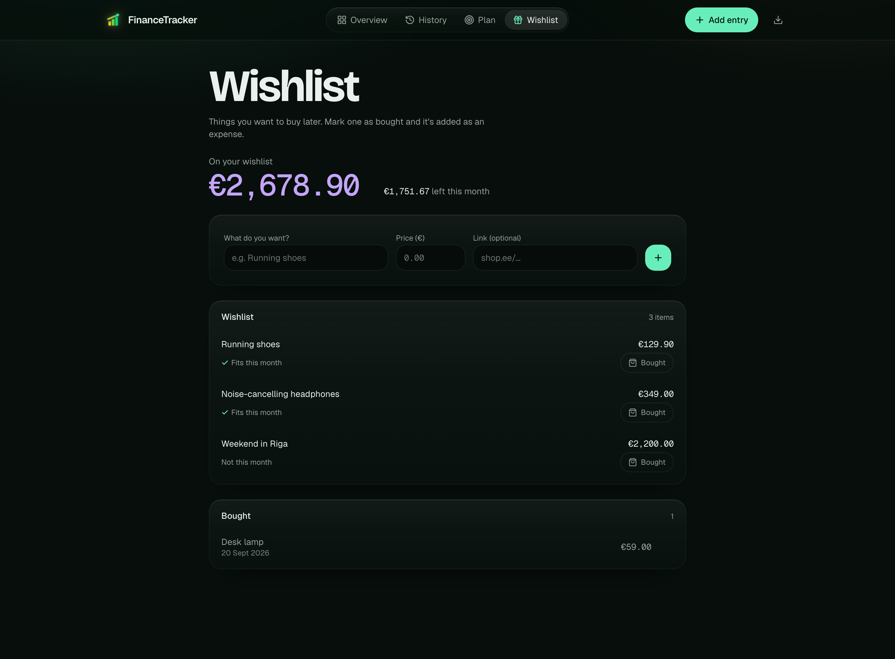
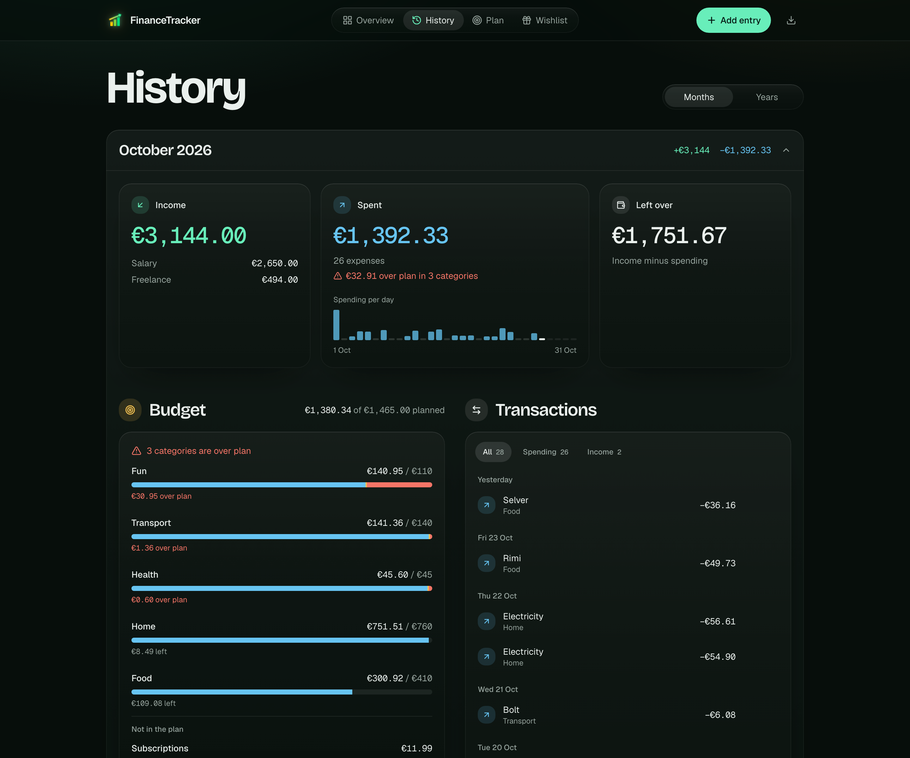

<div align="center">


# FinanceTracker

**A personal finance tracker that answers three questions at a glance:<br />what came in, what went out, and what's left.**

Track spending and income, plan the month ahead, keep a wishlist and import transactions straight from your bank.<br />Installable as an app on your phone and desktop.

### [Try the live demo](https://financetracker-live-demo.vercel.app)

<sub>Runs on sample data in your browser. No sign-up, nothing is sent anywhere.</sub>

<br />


<br />



</div>

<br />

## What it does

Every kind of information has one home, one colour and one icon, so you always know what you're looking at: **mint** is income, **sky blue** is spending, **gold** is your plan, **violet** is the wishlist, and **coral** only ever means "over plan".

### Overview: this month in three answers



- **Income, Spent, Left this month** as three cards, with where the income came from, a bar per day showing where the money went, and your real bank balance next to what's left.
- **Budget** puts the categories that went over plan first, and says in words how much is over or left ("€30.95 over plan", "€109 left").
- **Transactions** is one list for both directions, grouped by day, with a filter for spending or income. Every row can be edited or deleted in place.

### Plan: the month ahead, before it happens

<table>
  <tr>
    <td width="68%"></td>
    <td width="32%"></td>
  </tr>
</table>

- **Expected income − planned spending = what's left after the plan.** The sum updates while you type, so you can try out a number before saving it.
- **Named plan lines** such as "Rent" and "Electricity and internet" under Home, each with an optional link. Spending is compared per category, summing its lines.
- **Plan any month**, not just this one. An empty month offers to copy last month's plan in one click, and expected income can start from your recurring income.
- **Recurring** expenses and income (rent, salary) are added automatically each month and stay editable like any other entry.

### Add, Wishlist and History

<table>
  <tr>
    <td width="33%"></td>
    <td width="33%"></td>
    <td width="33%"></td>
  </tr>
</table>

- **Add** is built for the phone: a big amount field, categories as buttons, a clear "Expense saved" and a glance at the month underneath.
- **Wishlist** keeps things you want to buy later, shows which ones this month's balance already covers, and turns an item into an expense when you mark it bought.
- **History** lists every past month and year with its own spending strip, and opens each one in the same layout as Overview, with a 12-month trend chart for years.

<details>
<summary><b>More screenshots</b></summary>
<br />

| Add | Wishlist |
|---|---|
|  |  |

| History |
|---|
|  |

</details>

### Also included

| | |
|---|---|
| **Bank import** | Connect a bank account through [Enable Banking](https://enablebanking.com) (PSD2). Booked transactions are imported daily, categories are learned from how you sorted earlier ones, and the real balance shows on Overview. |
| **Reminders** | Web Push nudges on Sundays and at month-end to log anything you missed, even when the app is closed. |
| **Private by design** | Email and password sign-in with sign-ups closed, and every row in the database is locked to its owner with Postgres Row Level Security. |
| **Your data, exportable** | One click downloads a JSON backup of everything you own. |
| **Installable** | A PWA with a custom service worker. New versions take over on the next reload, and going offline shows a clear message instead of a broken screen. |

## Tech stack

| Layer | Choice |
|---|---|
| Frontend | Vite, React 18, TypeScript, [TanStack Router](https://tanstack.com/router) and [TanStack Query](https://tanstack.com/query) |
| Styling | Tailwind CSS v4, Bricolage Grotesque, Geist and Geist Mono (self-hosted), lucide-react icons, Recharts |
| Backend | [Supabase](https://supabase.com): Postgres with Row Level Security, Auth, three Deno Edge Functions, `pg_cron` |
| App shell | `vite-plugin-pwa` in `injectManifest` mode with a custom service worker (`src/sw.ts`) for push |
| Hosting | [Vercel](https://vercel.com) for the app and the demo, Supabase for data, auth and functions |

## How it's built

- **No separate backend.** The browser talks to Supabase directly and Row Level Security is the authorization model: every table is scoped to `auth.uid()`. Server-side code is limited to the SQL schema and three Edge Functions (reminders, bank connect, bank sync). The two cron-only functions check a shared secret kept in Supabase Vault, and the bank flow only accepts a callback that the same browser tab started.
- **All data access lives in one file.** `src/lib/finance-data.ts` holds every TanStack Query hook (expenses, income, categories, recurring items, plan lines, expected income, wishlist, bank connections).
- **Recurring items become real entries.** `useApplyRecurring` writes them into `expenses`/`incomes` once per month, linked back by `recurring_expense_id`/`recurring_income_id`, so they can be edited or deleted like anything else.
- **Plans are monthly.** Plan lines and expected income belong to a year and month; years in History show spending per category and a trend instead of a plan comparison.
- **The demo is the real app.** `npm run build:demo` swaps `src/lib/supabase.ts` for an in-browser stand-in (`src/lib/demo/`) at build time. Same components, same hooks, sample data saved to the visitor's `localStorage`, no network calls.

```
src/
  components/      Screens and building blocks: Dashboard (shell and navigation), PeriodPanel
                   (Overview and History), SummaryCards, CategoryBreakdown, Transactions,
                   PlanView and PlanIncome, WishlistView, AddView, HistoryView, DayStrip, Money …
  lib/
    finance-data.ts  Every query and mutation hook
    supabase.ts      Supabase client (replaced by lib/demo/supabase.ts in the demo build)
    demo/            Sample data and the in-browser data layer for the public demo
    auth.ts          Session state, sign in/up/out
    period.ts        Per-day and per-month totals, day grouping
    push.ts, bank.ts, export.ts, url.ts
  routes/          TanStack Router file routes
  sw.ts            Service worker: precaching, push notifications, instant updates
supabase/
  schema.sql       Tables, RLS policies, triggers, cron jobs. Idempotent, safe to re-run
  functions/       send-reminders, bank-connect, bank-sync
docs/screenshots/  Images used in this README (taken from the demo)
```

## Run it yourself

### 1. Install and start

```bash
npm install
cp .env.example .env.local   # fill in the three values below
npm run dev                  # http://localhost:3101
```

Just want to look around? `npm run dev:demo` runs the app on sample data with no Supabase project at all.

| Variable | Where to get it |
|---|---|
| `VITE_SUPABASE_URL` | Supabase dashboard → Settings → API |
| `VITE_SUPABASE_ANON_KEY` | Supabase dashboard → Settings → API (safe to expose to the browser) |
| `VITE_VAPID_PUBLIC_KEY` | `npx web-push generate-vapid-keys` (see reminders below) |

### 2. Database

Open your Supabase project's **SQL Editor** and run [`supabase/schema.sql`](supabase/schema.sql). It is idempotent, so it is also how you upgrade: re-run it after pulling new changes and only what's missing gets added. It creates every table, policy and trigger, including default categories for new sign-ups. Its last block closes sign-ups, so create your own account in the app before running the file the first time (or skip that block).

### 3. Reminders (optional)

Web Push needs a VAPID key pair and a deployed Edge Function, which needs the Supabase CLI:

```bash
npx web-push generate-vapid-keys        # public key goes into .env.local
npx supabase login
npx supabase link --project-ref <your-project-ref>
npx supabase secrets set VAPID_PUBLIC_KEY=... VAPID_PRIVATE_KEY=... CRON_SECRET=<long random string>
npx supabase functions deploy send-reminders --no-verify-jwt
```

The cron-only functions refuse any request without that secret, so nobody else can trigger them. Store the same value, plus your project URL, in Supabase Vault (SQL Editor), then run the `pg_cron` block in `schema.sql`:

```sql
select vault.create_secret('https://<project-ref>.supabase.co', 'project_url');
select vault.create_secret('<the same long random string>', 'cron_secret');
```

The function decides by itself whether today is a Sunday or the last day of the month.

### 4. Bank import (optional)

Create an application in [Enable Banking](https://enablebanking.com), then:

```bash
npx supabase secrets set ENABLE_BANKING_APP_ID=... ENABLE_BANKING_PRIVATE_KEY="$(cat private.pem)"
npx supabase functions deploy bank-connect
npx supabase functions deploy bank-sync --no-verify-jwt
```

`bank-sync` is scheduled by the second cron block in `schema.sql` and uses the same `CRON_SECRET`. Keep the private key out of the repository (`*.pem` is git-ignored).

## Scripts

| Command | What it does |
|---|---|
| `npm run dev` | Dev server on port 3101 |
| `npm run dev:demo` | Dev server with sample data instead of Supabase |
| `npm run build` | Type-check, then build the app and the service worker |
| `npm run build:demo` | The same build in demo mode |
| `npm run preview` | Serve the production build (needed to test the service worker) |

## Deployment

Both sites deploy from this repository on every push to `main`:

- **The app**: a Vercel project with the three `VITE_*` variables set. Point Supabase Auth's Site URL and Redirect URLs at its domain so confirmation emails link back correctly.
- **The demo**: a second Vercel project with one variable, `FT_DEMO=1`, which makes the normal `npm run build` produce the demo. It needs no Supabase keys.

`vercel.json` adds the SPA fallback, no-cache headers for `sw.js` and `manifest.webmanifest`, and security headers for every page: a Content Security Policy (scripts only from the app itself, network only to Supabase), no framing, `nosniff` and a strict referrer policy.

## License

[GPL-3.0](LICENSE.md)
